<div align="center">
  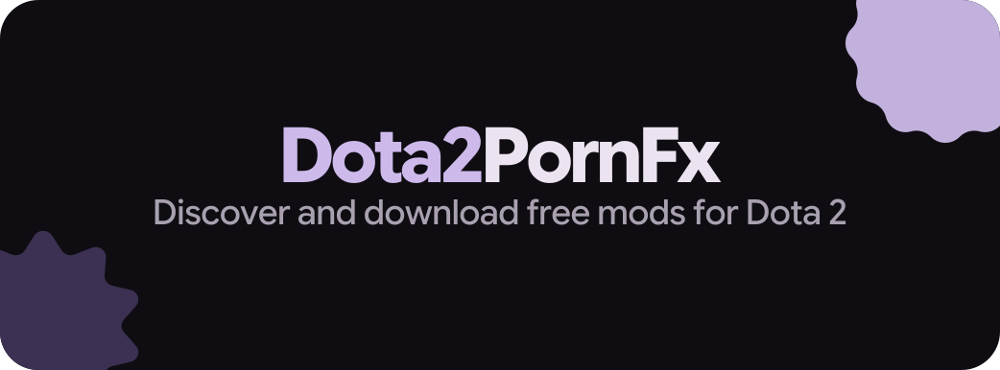

  <h3>The largest FREE collection of Dota 2 customization mods</h3>

  <p>
    <a href="https://h6rd.github.io/Dota2PornFxWeb"></a>
    <a href="https://d2pfxwiki.pages.dev/"></a>
    <a href="https://github.com/h6rd/Dota2PornFxStatus#live-status"></a>
    <a href="https://t.me/dota2pornfx"></a>
    <a href="https://discord.com/invite/PBvG8D9MxT"></a>
  </p>

  <p>
    <a href="https://discord.com/invite/PBvG8D9MxT">
      
    </a>
    <a href="https://github.com/h6rd/Dota2PornFxWeb/commits">
      
    </a>
    <a href="LICENSE">
      
    </a>
  </p>

  <p>
    <a href="#features">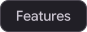</a>
    <a href="#screenshots">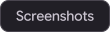</a>
    <a href="#project-activity">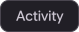</a>
    <a href="https://d2pfxwiki.pages.dev/en/install.html">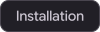</a>
    <a href="#credits">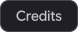</a>
    <a href="#attribution--reuse">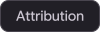</a>
  </p>
</div>

> [!WARNING]
> **Paid for access to Dota2PornFx? You may have been scammed.** The catalog is free to browse and download. We do not sell subscriptions or charge for access. Get the catalog only from the official sources (the [website](https://h6rd.github.io/Dota2PornFxWeb) and its mirror) or through the approved projects: [Minify](https://github.com/Egezenn/dota2-minify) and [Dota 2 Mod Manager](https://github.com/TheFleece/dota2-mod-manager).

<h3><a name="what-is-dota2pornfx"></a></h3>

**Dota2PornFx** is a comprehensive mod repository for Dota 2, giving players full control over the visual experience of their game. Browse and download custom hero skins, terrains, announcers, shaders, music, cursors, and much more.

<h3><a name="features"></a></h3>

<p align="center">
  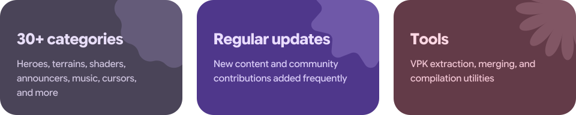
</p>

<h3><a name="screenshots"></a></h3>

<p align="center">
  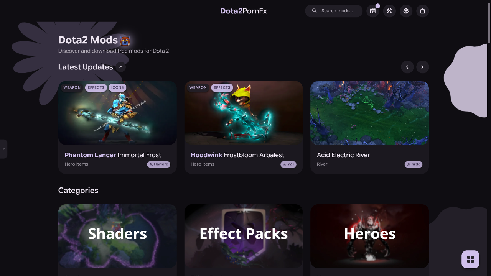
  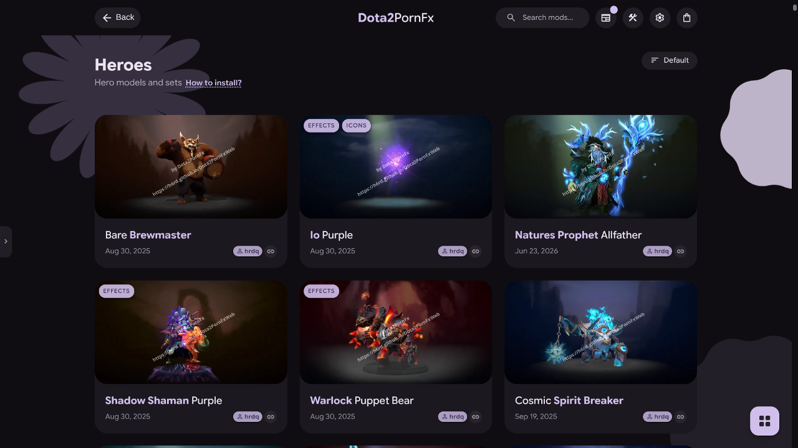
  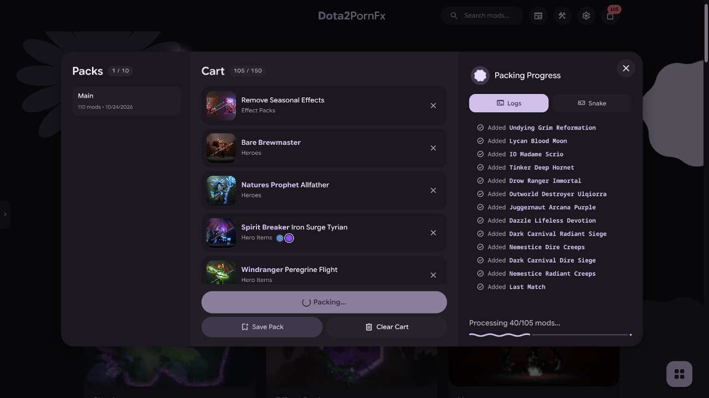
  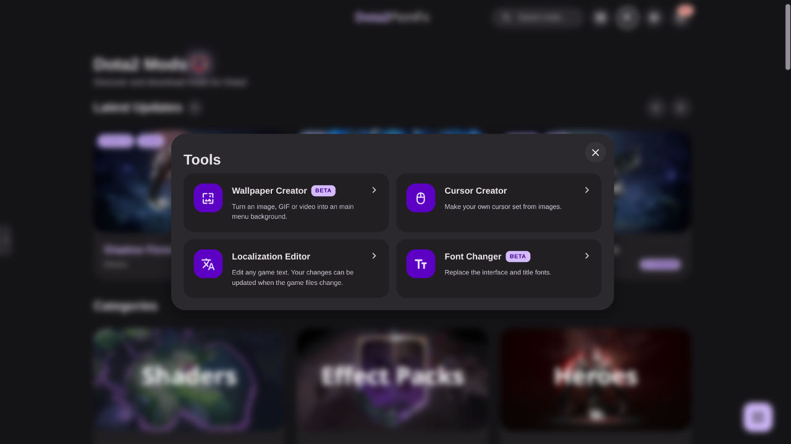
  <br>
  
  
  
  
</p>

<p align="center">
  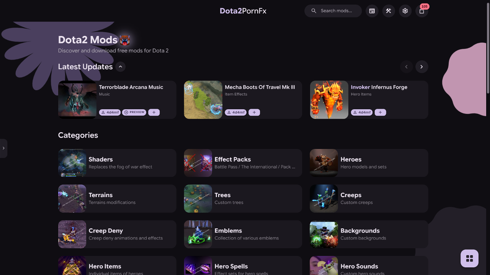
  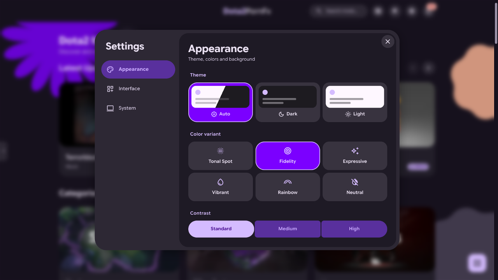
  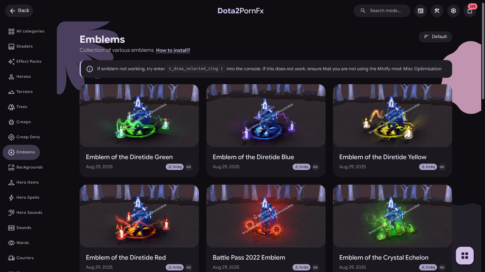
  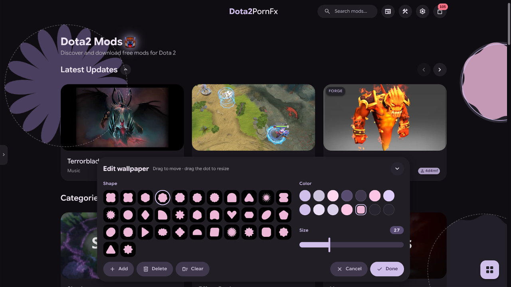
  <br>
  
  
  
  
</p>

<p align="center">
  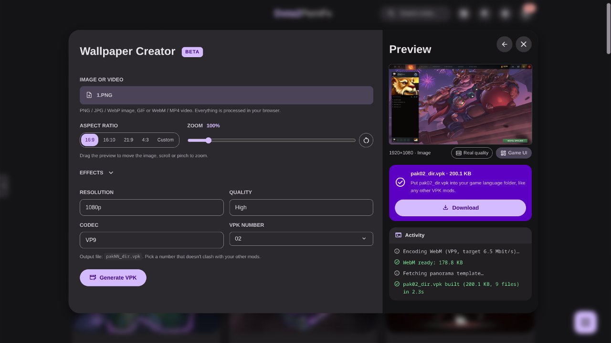
  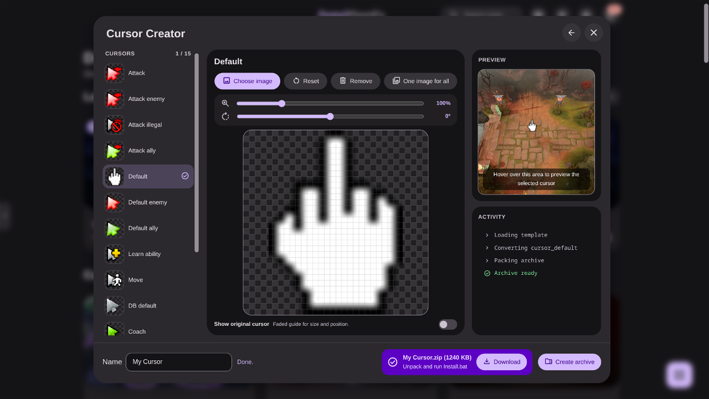
  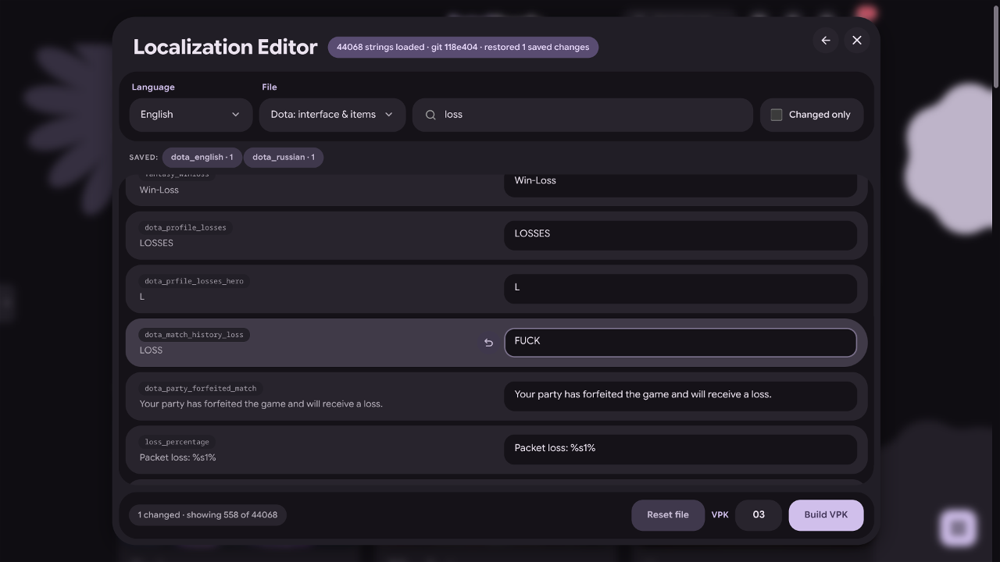
  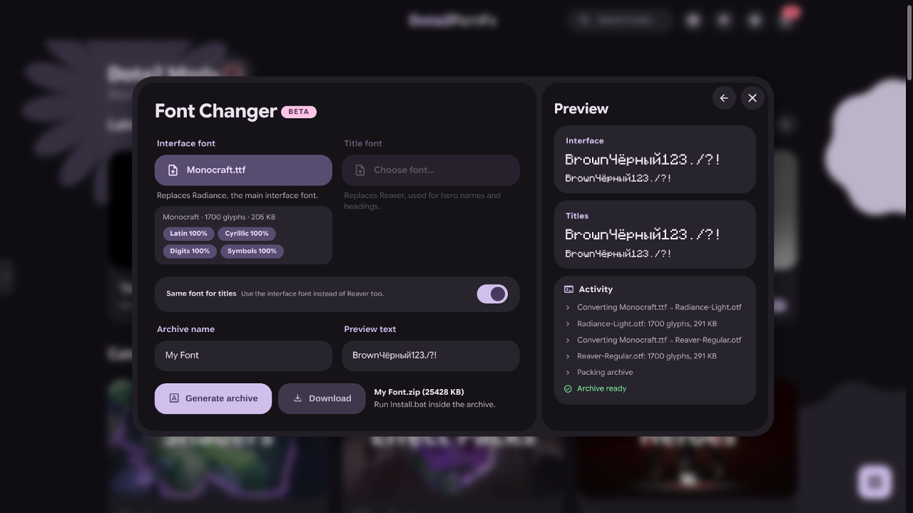
  <br>
  
  
  
  
</p>

<p align="center">
  <a name="project-activity"></a>
  
</p>

<h3><a name="installation"></a></h3>

<p align="center">
  <a href="https://d2pfxwiki.pages.dev/en/install.html"></a>
  <a href="https://d2pfxwiki.pages.dev/en/troubleshoot.html"></a>
</p>

<h3><a name="special-thanks"></a></h3>

- **[Egezenn](https://github.com/Egezenn)** — Integration with [Minify](https://github.com/Egezenn/dota2-minify) and the [metadata generation script](https://github.com/h6rd/Dota2PornFxWeb/blob/main/scripts/add_meta.py)
- **[Fleece](https://github.com/TheFleece)** — Creation of the [Dota 2 Mod Manager](https://github.com/TheFleece/dota2-mod-manager)
- **[ibcsz](https://github.com/ibcsz12)** — Added Santa hat to the logo for winter theme

<h3><a name="credits"></a></h3>

Content is sourced from the Dota 2 modding community. Original sources include:

- [**Dota2Changer**](https://dota2changer.com/)
- [**MOR**](https://vk.com/amir4anmods)

<details>
<summary><b>Mod Authors</b></summary>

<br>

[Egezenn](https://github.com/Egezenn) · [Robbyz](https://github.com/robbyz512) · [Darkness](https://t.me/Darkness_Logovo) · [Defiree](https://vk.com/defiree2mods) · [Kisilev](https://vk.com/id363951132) · [Amir4an](https://vk.com/amir4an) · [Skratch](https://www.youtube.com/@skratch) · [Lenz](https://www.youtube.com/@Lenz13377) · [Kliromin](https://www.youtube.com/@mrkliromin7723) · [Pinkpapa](https://www.patreon.com/Pinkpapa) · [laskotdota](https://t.me/laskotdota) · [NahuiToSay](https://t.me/NahuiToSay) · [lebensinhalt](https://t.me/turnoffyourlebensinhalt) · [Kynomi](https://vk.com/kynomi) · [Pinkie](https://steamcommunity.com/profiles/76561198142595363) · [VPKDota](https://t.me/vpkdota) · [ya_lyosha](https://www.twitch.tv/ya_lyosha) · [SanyaBane](https://steamcommunity.com/profiles/76561198072955043) · [Haruma](https://t.me/DotA_2_Mods) · kebabmaker · [YMOM77](https://t.me/mod_dota) · [Slipersone](https://t.me/slipersone) · [Timmyone](https://t.me/timmyone) · [HiddenPool](https://t.me/hiddenpoolcm) · [BackSpace](https://t.me/BackSpaceHub) · [zzzebra](https://vk.com/zzzfans) · [arti4e](https://t.me/d2modsreborn) · [Hooorde](https://steamcommunity.com/profiles/76561199405322406) · [HyrX](https://steamcommunity.com/profiles/76561198016243370) · [Sarath](https://steamcommunity.com/profiles/76561198127797541) · [Naix](https://www.youtube.com/channel/UCOfO6lf7jJO88NMlHDBkkCw) · [Shiro_R](https://t.me/shiro_rez) · [apathydxd](https://discord.com/users/538760177470668810) · [Dota2VPK](https://t.me/dota2freevpk) · [yoshimura](https://sites.google.com/view/yosh1mur2) · dabaqz · [Миша Талант](https://t.me/madberserker) · [Fr0dech](https://t.me/fr0dech_vpk) · DARK BLADE · [SkippingHades](https://www.youtube.com/@skippinghadesofficialmc) · [buba43](https://steamcommunity.com/profiles/76561199220865017) · [CeoMods](https://t.me/modsceo) · [Ромчик](https://watchmy.bio/shidehara) · [Mopsyara](https://t.me/+AM_aLD0x2TcwY2My) · [Vpotokwe](https://steamcommunity.com/sharedfiles/filedetails/?id=3766199700) · [Senop](https://t.me/senopD2) · [Arthas](https://t.me/ArthasModMaker) · [DotaMiniProfile](https://t.me/DotaMiniProfile) · [Fleece](https://github.com/TheFleece) · [qizlik](https://t.me/qizlikmod) · [ПАПАНЯ НА ШАМАНЕ](https://steamcommunity.com/profiles/76561199483735695/) · [SuperStas0](https://t.me/SuperStas0) · [Tenkay](https://t.me/dota2Tenkay) · [Aven](https://t.me/Aven1337) · [lansory](https://discord.com/users/1108248721768071210) · [333](https://t.me/cousf) · [depex](https://t.me/depexfx) · [cutyourhand](https://discord.com/users/835877516303925298) · [CiDDi](https://steamcommunity.com/profiles/76561198087399221) · [3atvorn1k](https://discord.com/users/642254136053596200) · [keeper](https://t.me/meetmeattheriver) · [spectr](https://discord.com/users/1531254146559250438) · hatsu · [hanfukj](https://t.me/hanfukj) · [Niski25](https://github.com/cus-nyam) · [lssqqqq](https://t.me/lssqqqq) · [hltw](https://discord.com/users/1012077862355996722) · [zitock](https://steamcommunity.com/profiles/76561198790474721/) · [wannakissyou](https://t.me/Ilya0sipov) · [александр](https://t.me/+VY-_XaaDg00wYmI6) · [YuyaKizami](https://t.me/YuyaKizami) · Morecursed · [ibcsz](http://t.me/nixwaretop) · Новомодный  · [J0nathan550](https://t.me/j0nvpk) · [мс яйцо](https://steamcommunity.com/id/mcegg/) · [rasstegai](https://steamcommunity.com/id/rasstegai/) · [твавт](https://steamcommunity.com/id/myasu0/) · [XIIIpsiblade](https://t.me/XIIIpsiblade) · [illidan](https://t.me/illidan888) · [shears001](https://discord.com/users/1204344805748903948) · [Harlord](https://t.me/harlord_mods) · [драг](https://t.me/dragvpk) · [Gibus](https://steamcommunity.com/id/nqkln/) · [cursedseizures](https://t.me/cvrsxdseizures) · [1995rnx](https://t.me/rnx1995rnx) · [YZT](https://t.me/YZTdota) · [not paradise](https://t.me/zitraks_second) · [Schizo](https://t.me/Schizo_shop) · [M1su](https://steamcommunity.com/id/A-ds/) · [hizu](https://steamcommunity.com/id/digitalsilenc3/) · [EmodzI](https://t.me/Moggdeli) · Mirik522 · [Tom4ik](https://steamcommunity.com/profiles/76561199427406113/) · [raddan](https://t.me/munet_kynu) · chineseg0d · [rizeru](https://t.me/rizeru) · [loveculted](https://t.me/loveculted) · zkll · [xvii](https://t.me/xviivpk) · [Swin-РукаBlood](https://discord.gg/SCnUSB4j6S) · [socialbottommm](https://t.me/+BhuRMghhq81hZDhi) · Defendor · [4d4mf](https://t.me/vpk4d4mmf) · [ittem](https://discord.com/users/1292235606184689735) · [Danulaguts]() · [Baste](https://projects.baste.ru/) · [drugponu](https://steamcommunity.com/id/drugponu/) · [fujitaki](https://t.me/fujitaki) · [qoofix](https://qoofix.ru) · [tapich](https://t.me/saigonosenjou) · [ataraxxxd](https://t.me/ataraxxxd) · [waitureally](https://t.me/s/waitureally)

</details>

<h3><a name="shoutouts"></a></h3>

<details>
<summary><b>Streamers & guide creators</b></summary>

<br>

- **Lenz** — [YouTube](https://www.youtube.com/@Lenz13377)
- **romantic** — [Twitch](https://www.twitch.tv/romantic991) / [TikTok](https://www.tiktok.com/@romantic_9991)
- **hanta** — [YouTube](https://www.youtube.com/@hqnta)
- **dricsy66** — [YouTube](https://www.youtube.com/@dricsy66)
- **Jez4** — [YouTube](https://www.youtube.com/@Jez4444)
- **SNOW SUCKER** — [YouTube](https://www.youtube.com/@AYE22814)
- **hypothermia** — [TikTok](https://www.tiktok.com/@methedonetherapy)
- **0cyzdau** — [TikTok](https://www.tiktok.com/@0cyzdau)
- **nedavovchik** — [TikTok](https://www.tiktok.com/@nedavovchik)
- **pr1me** — [TikTok](https://www.tiktok.com/@pr1meee_999)
- **ynnea** — [YouTube](https://www.youtube.com/@ynnea_too)

</details>

<h3><a name="libraries--resources"></a></h3>

- **[zip.js](https://github.com/gildas-lormeau/zip.js/)** — ZIP read/write in the browser
- **[lz-string](https://github.com/pieroxy/lz-string)** — LZ-based string compression
- **[m3e](https://github.com/matraic/m3e)** — Material 3 Expressive UI components
- **[mediabunny](https://github.com/Vanilagy/mediabunny)** — Working with videos for Wallpaper Creator
- **[GridStudio](https://github.com/linsisss/dota2-grid-toolkit)** — Inspiration for the Wallpaper Creator
- **[DOTA 2 VPK Updates](https://github.com/spirit-bear-productions/dota_vpk_updates)** — Game localization files for the Localization Editor

<h3><a name="license"></a></h3>

- **Website and tool code** — [GPL-3.0](LICENSE)
- **Content**: mods marked `author: hrdq`, mods submitted through the website with the author's confirmation, and the catalog — [LICENSE-CONTENT.md](LICENSE-CONTENT.md)
- **Other mods**, without either mark — Their authors' rights. **Not licensed by this project**
- **Valve assets** inside mods — Valve's rights

Commits up to and including `00f52750112435bb183633a4f982ea335b8ed84a` were released under GPL-3.0 and stay under it for those who received them. From the next commit on, the Content is under the Content License, including files that existed before. Details: [ATTRIBUTION.md](ATTRIBUTION.md).

<h3><a name="attribution--reuse"></a></h3>

**Other authors' mods.** This project does not license them; their authors' rights apply. To republish another author's mod you need **that author's** permission, and mine does not replace it. Authors can ask for removal at any time (Discord `.hrdq`, email `hrdq@proton.me` or an issue naming the mod); it is removed within 7 days after authorship is confirmed.

**For the Content** (mods marked `author: hrdq`, mods submitted through the website with the author's confirmation, and the catalog). Authors who submit a mod through the website confirm that it is licensed under the Content License, allow it to be distributed to the approved projects below, and can ask to change or remove it at any time:


- 🎮 **Personal use.** Download, install and modify for your own game.
- 🎥 **Streams, videos, guides, reviews**, including monetized channels. A link is appreciated.
- 🔗 **Link** to the website, the repository and the official mirrors.
- 🤝 **Approved projects** (listed below).

> [!CAUTION]
> **Selling is prohibited completely.** Selling the Content, charging for access or earning from its distribution (subscriptions, premium features, paywalls, ads around downloads, paid bundles) is not allowed, and permission is not given to anyone. Voluntary donations that unlock nothing are fine.


- 🪞 **Mirrors and re-uploads** of the catalog or a substantial part of it, other than the official ones.
- 🤖 **Sites, apps or bots** that connect to the catalog (API, hot-linking, scraping) or republish and redistribute the Content.
- 🚫 **Presenting the Content as your own or as official**, or removing author tags and watermarks.

**Official sources:** [website](https://h6rd.github.io/Dota2PornFxWeb) · mirrors: [Vercel](https://d2pfx.vercel.app/), [Netlify](https://d2pfx.netlify.app/), [Render](https://d2pfx.onrender.com/) · [GitHub](https://github.com/h6rd/Dota2PornFxWeb) · [Hugging Face](https://huggingface.co/datasets/hrdq/Dota2PornFx)

**Approved projects**

- [Dota2 Minify](https://github.com/Egezenn/dota2-minify)
- [Dota 2 Mod Manager](https://github.com/TheFleece/dota2-mod-manager)

Approval covers only the projects named above, not their forks or derivatives, requires free access and credit to the authors, and can be withdrawn. Projects not listed are not officially approved or endorsed. Valid permissions are recorded in [PERMISSIONS.md](PERMISSIONS.md).

**Ready-to-copy text:**

```
Mods from [Dota2PornFx](https://h6rd.github.io/Dota2PornFxWeb).
Original mod authors: https://github.com/h6rd/Dota2PornFxWeb#credits
```

Full terms: **[LICENSE-CONTENT.md](LICENSE-CONTENT.md)** · **[ATTRIBUTION.md](ATTRIBUTION.md)**
